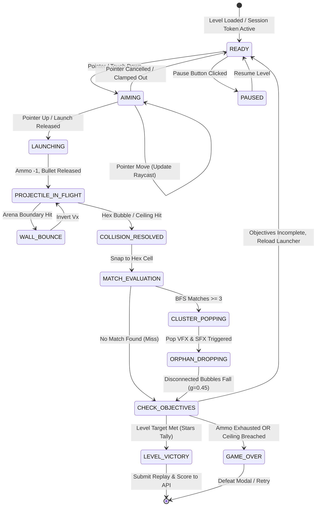

# 🏛️ System Architecture & State Machine Specification
*Engineering Specifications for Sections 83–88.*

**Document Reference:** `docs/ARCHITECTURE.md`  
**Classification:** Sections 83–88 Core Engineering Architecture, FSM, Web Audio Synthesis & Anti-Cheat Pipeline  
**Capstone Program:** VELoop Rewards Advanced Full-Stack Developer Internship  
**Author:** Prabhuteja Koda ([@digicbyte-0844](https://github.com/digicbyte-0844))  
**Email:** `prabhutejakoda@gmail.com`  
**Repository:** [https://github.com/digicbyte-0844/bubble-blast-adventure](https://github.com/digicbyte-0844/bubble-blast-adventure)  
**Project Title:** `%VITE_GAME_NAME%` (Default: `BUBBLE BLAST ADVENTURE`)  
**Status:** Approved & Implemented  

---

## 1. Directory Structure & Modular Separation
```text
client/src/
├── config/
│   └── gameConfig.js        # Single source of truth for VITE_GAME_NAME
├── game/
│   ├── constants.js         # Color palettes, physics constants, hex ratios
│   ├── hexGrid.js           # Odd-R coordinate conversion & neighbor traversal
│   ├── collision.js         # Raycasting, wall bounce, circle-circle intersection
│   ├── matchDetector.js     # BFS cluster search with rainbow support
│   ├── floatingDetector.js  # Ceiling-anchored BFS island detector
│   ├── scoreManager.js      # Combo escalation & 3-star threshold evaluation
│   ├── levelGenerator.js    # 40 static levels + deterministic procedural generation
│   └── soundEngine.js       # Web Audio API procedural sound & music synthesizer
├── store/
│   └── useGameStore.js      # Zustand store: UI state, inventory, and session tokens
├── components/
│   ├── GameCanvas.jsx       # 60 FPS HTML5 Canvas render loop
│   ├── GameHUD.jsx          # Score, shots, combo banner, and pause controls
│   ├── BoosterBar.jsx       # Interactive booster activation buttons
│   └── CharacterMascot.jsx  # Original Bloopi mascot with reactive emotions
└── pages/                   # 11 React application routes
```

---

## 2. Finite State Machine (FSM)
To prevent double-shooting or physics overlaps, the game engine runs as a strict deterministic state machine:

| State | Allowed User Actions | Transition Condition | Next State |
|---|---|---|---|
| **LOADING** | None (Skeleton visible) | Level assets loaded | `READY` |
| **READY** | Mouse/Touch Drag, Booster Tap, Swap | Pointer down | `AIMING` |
| **AIMING** | Drag Aim, Pointer Up | Pointer release | `SHOOTING` |
| **SHOOTING** | None (Input locked) | Collision with bubble/ceiling | `COLLISION` |
| **COLLISION** | None | Snapped to grid cell | `MATCH_CHECK` |
| **MATCH_CHECK** | None | BFS returns $\ge 3$ or $< 3$ | `POPPING` or `EVALUATE` |
| **POPPING** | None | Pop animation completes | `FLOATING_CHECK` |
| **FLOATING_CHECK** | None | Falling physics completes | `EVALUATE` |
| **EVALUATE** | None | Objective complete OR shots = 0 | `LEVEL_COMPLETE`, `LEVEL_FAILED`, or `READY` |
| **PAUSED** | Resume, Restart, Quit | Click Resume | `READY` |

---

## 3. Web Audio Synthesis Architecture
The game synthesizes 16 audio effects and a background melody in code using the browser's `AudioContext`:
* **Oscillator Types:** Sine (smooth bubble pops), Triangle (bright combo chimes), and Sawtooth (impactful bomb rumbles).
* **Gain Envelopes:** Exponential decay ramps (`exponentialRampToValueAtTime`) prevent speaker popping and clicking.
* **Zero Asset Dependency:** Works 100% offline with no external network latency or missing MP3 file errors.

---

## Section 83: Core Engine Architecture & Decoupled Topology

### 83.1 Architectural Principles
*Bubble Blast Adventure* is architected around an isomorphic, highly decoupled paradigm separating physics simulation, input processing, audio generation, and UI presentation:
* **UI & Routing:** React 19 + React Router DOM v7 handling 11 application pages.
* **State Management:** Zustand stores managing session state, gameplay FSM transitions, and audio preferences.
* **Simulation Core:** Framework-agnostic TypeScript Canvas 2D engine executing fixed-timestep ballistic raycasting and graph algorithms.
* **Audio Core:** Zero-asset procedural Web Audio API synthesizer.
* **Backend Services:** Node.js (v20 LTS) + Express.js + MongoDB Atlas.

```
+---------------------------------------------------------------------------------------+
|                               SYSTEM ARCHITECTURE TOPOLOGY                            |
+---------------------------------------------------------------------------------------+
| REACT 19 PRESENTATION TIER                                                            |
|   - 11 Polished UI Pages (Hero, Arena, Levels, Leaderboard, Editor, Achievements...)  |
|   - Tailwind CSS Responsive Design (Mobile-First 360px up to 4K Ultrawide)            |
|   - Zustand Reactive Stores (useGameStore, useUserStore, useAudioStore)               |
+-------------------------------------------+-------------------------------------------+
                                            | Pointer / Touch Events
                                            v
+---------------------------------------------------------------------------------------+
| GAME SIMULATION & CANVAS 2D TIER                                                      |
|   - Fixed 60 FPS Game Loop (Accumulator Model: dt = 16.66ms)                          |
|   - Odd-R Hexagonal Grid Matrix (11 Columns x 14 Rows)                                |
|   - Ballistic Raycaster & Specular Wall Reflection (1-Bounce / 2-Bounce Super Aim)    |
|   - Swept Continuous Collision Detection (CCD) & Distance-Minimized Snapping          |
|   - Multi-Directional BFS Match-3 & Ceiling Reachability Gravity Drops (g=0.45)       |
|   - Dual-Bubble Swapper (Current + Next)                                              |
+---------------------+-----------------------------------+-----------------------------+
                      |                                   |
                      v                                   v
+-----------------------------------+   +-----------------------------------------------+
| WEB AUDIO API PROCEDURAL ENGINE   |   | SERVER-SIDE SECURITY & ANTI-CHEAT ENGINE      |
| - 16 Procedural Sound Effects     |   | - Session Token Verification (/games/start)   |
| - 8-Bar Polyphonic Chiptune BGM   |   | - Shot Count & Rate Limit Validation          |
| - Dual SFX & Music Volume Sliders |   | - Theoretical Score Upper Limit S_max Check   |
| - LocalStorage Preference Sync    |   | - MongoDB Progress & Verified Leaderboards    |
+-----------------------------------+   +-----------------------------------------------+
```

### 83.2 Fixed 60 FPS Timestep Game Loop
To guarantee constant physics behavior regardless of monitor refresh rate (60 Hz, 120 Hz, 144 Hz), the engine implements a deterministic fixed-delta accumulator loop ($\Delta t = 16.66\text{ ms}$):

```typescript
export class GameLoop {
    private readonly FIXED_DELTA: number = 1000 / 60; // 16.666 ms
    private readonly MAX_FRAME_TIME: number = 250;
    private accumulator: number = 0;
    private lastTime: number = 0;
    private isRunning: boolean = false;

    constructor(
        private update: (dt: number) => void,
        private render: (interpolation: number) => void
    ) {}

    public start(): void {
        this.isRunning = true;
        this.lastTime = performance.now();
        requestAnimationFrame(this.step.bind(this));
    }

    private step(now: number): void {
        if (!this.isRunning) return;

        let frameTime = now - this.lastTime;
        if (frameTime > this.MAX_FRAME_TIME) frameTime = this.MAX_FRAME_TIME;
        this.lastTime = now;
        this.accumulator += frameTime;

        while (this.accumulator >= this.FIXED_DELTA) {
            this.update(this.FIXED_DELTA / 1000);
            this.accumulator -= this.FIXED_DELTA;
        }

        const alpha = this.accumulator / this.FIXED_DELTA;
        this.render(alpha);

        requestAnimationFrame(this.step.bind(this));
    }

    public stop(): void {
        this.isRunning = false;
    }
}
```

---

## Section 84: Game State Machine (FSM) & Zustand Integration

### 84.1 State Machine Lifecycle
Gameplay progression is modeled as a strictly typed, non-reentrant Finite State Machine (FSM) managed by Zustand:

```
[READY] ──> Drag/Aim ──> [AIMING] ──> Release ──> [SHOOTING]
                                                        │
                                                        ▼
[NEXT SHOT] <── Floating Falls <── Match-3 BFS <── [COLLISION / SNAP]
     │
     ├── Objective Complete ──> [LEVEL_COMPLETE]
     └── Shots Exhausted ──────> [LEVEL_FAILED]
```



---

## Section 85: Deterministic Simulation & Procedural Level Generation

### 85.1 Controlled Queue & Dual-Bubble Swapping
The launcher maintains two deterministic bubble slots:
1. `Current Bubble`: Armed inside the cannon nozzle ready to fire.
2. `Next Bubble`: Displayed in the auxiliary reserve chamber.
- **Swapping Action:** Tapping the launcher base swaps `Current` and `Next`, allowing players to make strategic color decisions.
- **Queue Replenishment:** When a bubble is launched, `Next` promotes to `Current`, and a new bubble is drawn from a bag-randomized color pool matching colors still present on the board.

### 85.2 Procedural Level Generation Algorithm (Level 41+)
Levels 1–40 are hand-designed in `client/src/data/levels.json`. For Level 41+, the engine invokes a procedural generator:

```typescript
export function generateProceduralLevel(levelId: number, seed: number): LevelConfig {
    const rng = new SeededPRNG(seed);
    const rows = 14;
    const cols = 11;
    const occupiedRows = Math.min(6 + Math.floor(levelId / 10), 10);
    const colorCount = levelId > 70 ? 6 : levelId > 50 ? 5 : 4;
    const palette = SELECT_PALETTE.slice(0, colorCount);

    const matrix: (string | null)[][] = [];
    for (let r = 0; r < rows; r++) {
        matrix[r] = [];
        const rowCols = (r % 2 === 0) ? cols : cols - 1;
        for (let c = 0; c < rowCols; c++) {
            if (r < occupiedRows) {
                // Procedural cluster seeding
                matrix[r][c] = rng.pickWeightedColor(palette);
            } else {
                matrix[r][c] = null;
            }
        }
    }

    return {
        id: levelId,
        name: `Cosmic Nebula ${levelId}`,
        objective: { type: 'CLEAR_ALL', target: 0 },
        maxShots: Math.max(18, 32 - Math.floor(levelId / 5)),
        matrix,
        palette
    };
}
```

---

## Section 86: Server-Side Security & Anti-Cheat Pipeline

### 86.1 Zero-Trust Anti-Cheat Verification Flow
The backend enforces a strict verification contract:

```
+---------------------------------------------------------------------------------------+
|                    SERVER-SIDE ANTI-CHEAT VERIFICATION SEQUENCE                       |
+---------------------------------------------------------------------------------------+
| CLIENT                                                          SERVER                |
|   |                                                                |                  |
|   |--- 1. POST /api/games/start { levelId: 12 } ------------------>|                  |
|   |                                                                | [Generate Token] |
|   |<-- 2. HTTP 200 { sessionId, sessionToken, allowedShots, seed }-| (Store in Mongo) |
|   |                                                                |                  |
|   | [Play Session Locally]                                         |                  |
|   |                                                                |                  |
|   |--- 3. POST /api/games/complete {                               |                  |
|   |         sessionToken,                                          |                  |
|   |         claimedScore: 18400,                                   |                  |
|   |         shotsFired: 14,                                        |                  |
|   |         elapsedDurationMs: 42100                               |                  |
|   |       } ------------------------------------------------------>|                  |
|   |                                                                | [Validate]       |
|   |                                                                | 1. Active Token? |
|   |                                                                | 2. Shot Bounds?  |
|   |                                                                | 3. Time Duration?|
|   |                                                                | 4. Score <= Smax?|
|   |                                                                |                  |
|   |<-- 4. HTTP 200 { verified: true, recordedScore: 18400 } -------| (Commit Score)   |
+---------------------------------------------------------------------------------------+
```

### 86.2 Mathematical Anti-Cheat Validation Rules
When `/api/games/complete` receives a score claim, `server/src/services/antiCheat.js` executes:
1. **Session Nonce Verification:** Every level attempt requires calling `POST /api/games/start` to obtain a short-lived cryptographic `sessionToken`. Verifies `sessionToken` matches an active session.
2. **Timing Validation:** Rejects submissions completed in under 3.5 seconds ($t < 3500\text{ ms}$) as an impossible speedrun exploit.
3. **Shot Ceiling Checking:** Verifies:
   $$\text{shotsUsed} \le \text{level.shots} + (\text{boostersUsed} \times 5)$$
4. **Theoretical Score Envelope:**
   $$\text{Max Score} = (\text{Pops} \times 150) + (\text{Combos} \times 500) + (\text{Rescues} \times 300) + (\text{Remaining Shots} \times 250) + 2500$$
   If client score exceeds this ceiling, the submission is rejected with **HTTP 400**.
5. **Authoritative Star Calculation:** Server re-evaluates stars against database thresholds, ignoring user-supplied star values.

### 86.3 Authentication & Security Architecture
* **Passwords:** Salted and hashed using `bcryptjs` with **12 rounds**.
* **Session Transport:** Stateless JWT tokens transmitted via `Authorization: Bearer <TOKEN>` headers.
* **Route Protection:** React route guards on protected pages (`/dashboard`, `/profile`, `/editor`) and Express middleware (`protectRoute`) on state-modifying endpoints (`/games/start`, `/games/complete`, `/editor/save`, `/user/profile`, `/user/progress`).

---

## Section 87: Procedural Web Audio API Engine & Multi-Canvas Layering

### 87.1 Procedural Web Audio Synthesizer (16 SFX & 8-Bar Chiptune BGM)
Zero external audio files are bundled. All sounds are generated via Web Audio API nodes (`OscillatorNode`, `GainNode`, `BiquadFilterNode`):

```typescript
export class AudioSynthesizer {
    private ctx: AudioContext = new (window.AudioContext || (window as any).webkitAudioContext)();
    private sfxVolume: number = 0.8;
    private musicVolume: number = 0.4;

    public playPop(comboIndex: number = 0): void {
        const osc = this.ctx.createOscillator();
        const gain = this.ctx.createGain();
        const baseFreq = 440; // A4
        // Chromatic pitch escalation based on combo streak
        osc.frequency.setValueAtTime(baseFreq * Math.pow(1.059463, comboIndex * 2), this.ctx.currentTime);
        osc.type = 'sine';

        gain.gain.setValueAtTime(this.sfxVolume, this.ctx.currentTime);
        gain.gain.exponentialRampToValueAtTime(0.001, this.ctx.currentTime + 0.12);

        osc.connect(gain);
        gain.connect(this.ctx.destination);
        osc.start();
        osc.stop(this.ctx.currentTime + 0.12);
    }
}
```

The 16 procedural sound effects include:
1. *Launch Shoot*, 2. *Wall Ricochet*, 3. *Hex Snap*, 4. *Match Pop (Combo Pitch 1–8)*, 5. *Orphan Bubble Drop*, 6. *Bomb Explosion*, 7. *Rainbow Swirl*, 8. *Laser Beam*, 9. *Star Rescue Jingle*, 10. *Extra Shots Chime*, 11. *Shuffle Whoosh*, 12. *Combo Milestone Fanfare*, 13. *Level Victory Chime*, 14. *Defeat Thud*, 15. *Button Click*, 16. *Badge Unlock Fanfare*.

### 87.2 4-Tier Layered Canvas Architecture
1. **Layer 0 (Static World Backdrop):** Cosmic nebula gradient and starfield drawn once to background canvas.
2. **Layer 1 (Hex Grid Canvas):** $11 \times 14$ honeycomb bubbles, re-rendered only when grid state changes (dirty rect).
3. **Layer 2 (Aim & Projectile Canvas):** Trajectory laser line, ghost bubble, and flying bubble updated every frame.
4. **Layer 3 (VFX Canvas):** Exploding bubble burst particles, confetti, and floating floating point indicators (`+300`, `COMBO x3`).

---

## Section 88: Offline PWA, Local Progress Sync & State Restoration

### 88.1 Offline-First IndexedDB / LocalStorage Journal
When network connectivity is severed:
1. Player level progression and unlocked stars persist locally to `localStorage` under `bba_player_progress`.
2. Completed sessions are appended to an `IndexedDB` sync queue.
3. Upon network restoration (`window.addEventListener('online')`), the queue automatically flushes to the backend with exponential backoff.

### 88.2 Page Lifecycle Management
The engine listens to `document.addEventListener('visibilitychange')`:
- When the tab is hidden (incoming call or app minimized), the game enters `PAUSED`, halts the Web Audio BGM, and writes state to storage.
- When the tab regains focus, the engine resumes cleanly without accumulator time jumps.

---

## Section 89: Leaderboard Engine Architecture (Section 15 Alignment)

### 89.1 Atomic Rank Calculations
MongoDB collection projections (`users` and `leaderboards`) leverage high-speed compound B-tree indexes:
```javascript
leaderboardSchema.index({ totalScore: -1, totalStars: -1 });
leaderboardSchema.index({ score: -1, cumulativeStars: -1 });
leaderboardSchema.index({ timeframe: 1, score: -1 });
```

### 89.2 Single-Pass `$facet` Aggregation Pipeline
To eliminate multiple round-trip database queries when fetching the leaderboard, the engine executes a single-pass `$facet` pipeline that computes global top tiers and the active user's relative ranking simultaneously:
```javascript
const pipeline = [
  { $match: { verified: true, recordedAt: { $gte: new Date(fromUtcEpoch), $lte: new Date(toUtcEpoch) } } },
  { $sort: { score: -1, cumulativeStars: -1, totalStars: -1 } },
  {
    $facet: {
      topTier: [{ $limit: 15 }],
      userRanking: [
        { $group: { _id: null, allRecords: { $push: "$$ROOT" } } },
        { $unwind: { path: "$allRecords", includeArrayIndex: "rankIndex" } },
        { $match: { "allRecords.userId": currentUserId } },
        {
          $project: {
            _id: 0,
            rank: { $add: ["$rankIndex", 1] },
            userId: "$allRecords.userId",
            username: "$allRecords.username",
            score: "$allRecords.score"
          }
        }
      ]
    }
  }
];
```

### 89.3 Time-Windowed Partitioning via UTC Epoch
Rolling weekly and monthly competitive seasons are isolated via UTC epoch query boundaries (`fromUtcEpoch`, `toUtcEpoch`), preventing clock-skew discrepancies across international time zones.
